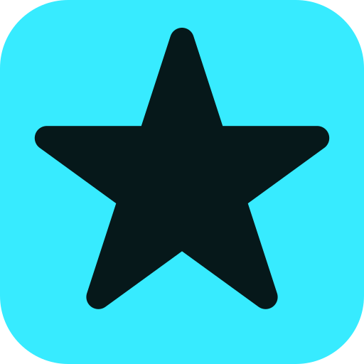

<h1 align="center">kmmiio99o Plugins </h1>

<strong>Plugins for Valenced, built by kmmiio99o.</strong>

A monorepo of external Valenced plugins and themes.

## ❓ About

Valenced is a client modification for Discord mobile, allowing you to customize your Discord experience with plugins that can extend Discord's functionality, customize its appearance, and enable experimental features.

This repository is a **plugin repository**. Each plugin becomes one ZIP file, and the repository serves them through `index.json`. Add this repository in **Settings** > **Valenced** > **Repositories**, then install plugins from **Plugins** > **[+]**.

## 🔌 Plugins

| Name | Description | Authors | ID | Version |
| --- | --- | --- | --- | --- |
| [CloudSync](plugins/cloud-sync) | Sync and back up your plugins, themes, and settings to the cloud. | kmmiio99o <879393496627306587> (https://github.com/sponsors/kmmiio99o "Donations") (https://kmmiio99o.dev "Website") (https://github.com/kmmiio99o "GitHub") | `dev.kmmiio99o.cloud.sync` | 1.0.0 |
| [Custom RPC](plugins/custom-rpc) | Set a fully custom Rich Presence activity on your profile. | kmmiio99o | `dev.kmmiio99o.custom.rpc` | 1.0.0 |
| [Expression Utils](plugins/expression-utils) | Adds useful actions to custom emoji and sticker sheets, including cloning expressions to servers you manage. | kmmiio99o <879393496627306587> (https://github.com/sponsors/kmmiio99o "Donations") (https://kmmiio99o.dev "Website") (https://github.com/kmmiio99o "GitHub"), Livie <755950362342457384> | `dev.kmmiio99o.expression-utils` | 1.1.0 |
| [Material You Expressive](plugins/material-you-expressive) | Restyles Discord after Material 3 Expressive: rounder shapes, pill buttons, segmented lists, M3 controls and shaped avatars. | kmmiio99o <879393496627306587> (https://github.com/sponsors/kmmiio99o "Donations") (https://kmmiio99o.dev "Website") (https://github.com/kmmiio99o "GitHub"), dim (https://github.com/dim-ghub "GitHub") (https://dim.contact "Website") | `dev.kmmiio99o.material-you-expressive` | 0.6.3 |
| [Message Context Menu](plugins/message-context-menu) | Replaces Discord's message long-press sheet with an anchored chat-style menu. | kmmiio99o <879393496627306587> (https://github.com/sponsors/kmmiio99o "Donations") (https://kmmiio99o.dev "Website") (https://github.com/kmmiio99o "GitHub") | `dev.kmmiio99o.imessage-context-menu` | 1.1.0 |
| [Song Spotlight](plugins/song-spotlight) | Show songs on your Discord profile, with previews and link sharing. | kmmiio99o <879393496627306587> (https://github.com/sponsors/kmmiio99o "Donations") (https://kmmiio99o.dev "Website") (https://github.com/kmmiio99o "GitHub"), nexpid <853550207039832084> (https://github.com/nexpid/RevengePlugins "Original plugin") | `dev.kmmiio99o.song-spotlight` | 1.0.1 |

## 🎨 Themes

| Name | Description | Authors | ID | Version |
| --- | --- | --- | --- | --- |
| [Midnight Vencord](themes/midnight-vencord) | A Gruvbox-inspired midnight dark theme. | kmmiio99o <879393496627306587> (https://github.com/sponsors/kmmiio99o "Donations") (https://kmmiio99o.dev "Website") (https://github.com/kmmiio99o "GitHub") | `dev.zaveqo.midnight-vencord` | 1.0.0 |
| [Plumpy](themes/plumpy) | Replaces Discord's icons with ones from the Plumpy icon pack. | kmmiio99o <879393496627306587> (https://github.com/sponsors/kmmiio99o "Donations") (https://kmmiio99o.dev "Website") (https://github.com/kmmiio99o "GitHub"), Rairof (https://github.com/Rairof "Plumpy icon pack") | `dev.zaveqo.plumpy` | 1.0.0 |
